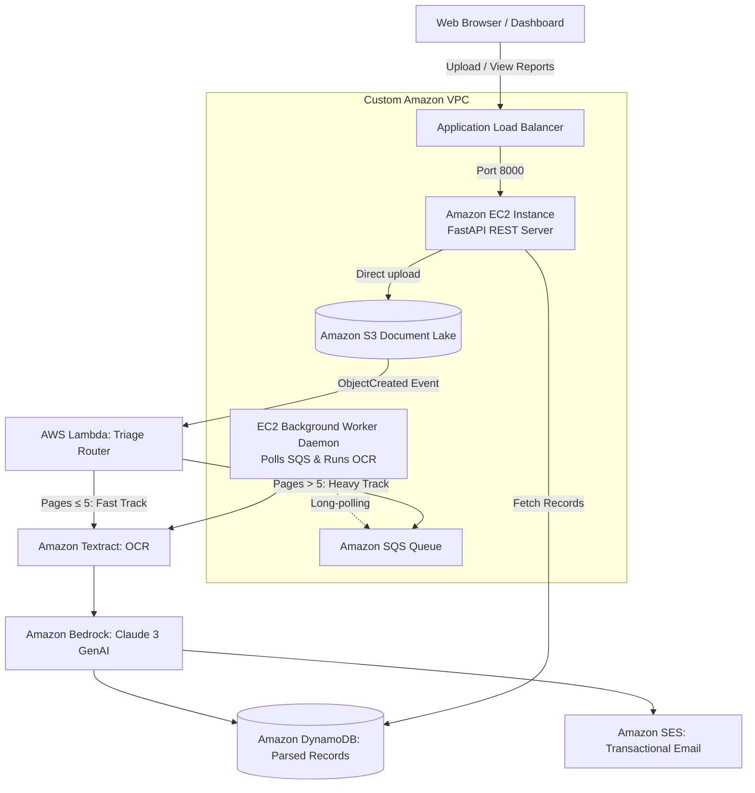

# DocuCloud AI 🚀
### Hybrid Cloud Document Processing & Financial Audit Platform

[](https://aws.amazon.com/)
[](https://python.org)
[](https://fastapi.tiangolo.com)
[](https://aws.amazon.com/bedrock/)

**DocuCloud AI** is a production-grade, multi-service AWS architecture that intelligently parses receipts, invoices, and contracts. It demonstrates a **hybrid cloud pattern**: balancing serverless auto-scaling (AWS Lambda) for lightweight receipts with resilient IaaS (Amazon EC2 + SQS) for heavy multi-page documents, while leveraging AWS Textract for OCR and Amazon Bedrock for generative financial audits.

---

## 🏛️ Architecture Overview



---

## 🧰 AWS Services Breakdown (10 Services)

| AWS Service | Architectural Role |
| :--- | :--- |
| **Amazon EC2** | Hosts the FastAPI REST API and runs the continuous SQS background worker daemon |
| **AWS Lambda** | Event-driven triage router triggered on S3 uploads; executes fast-path for lightweight docs |
| **Amazon S3** | Secure document lake with CORS enabled for direct browser pre-signed uploads |
| **Amazon DynamoDB** | Fast NoSQL storage for extracted metadata, line items, and audit insights |
| **Amazon SQS** | Decouples heavy/multi-page OCR processing jobs to prevent server overload or Lambda timeouts |
| **Amazon Textract** | Extracts structured form data, key-value pairs, and itemized receipt tables |
| **Amazon Bedrock** | Generative AI (Claude 3 / Titan) for expense categorization, anomaly detection, and summaries |
| **Amazon SES** | Sends branded HTML summary email notifications with anomaly alerts to stakeholders |
| **Application Load Balancer (ALB)** | Routes incoming traffic across EC2 instances in a VPC |
| **Amazon CloudWatch** | Aggregates application logs, Lambda metrics, and worker performance alarms |

---

## 📂 Project Structure

```
cloud_project/
├── backend/
│   ├── app/
│   │   ├── main.py                # FastAPI REST API & Dashboard endpoint
│   │   ├── config.py              # Boto3 session & environment loader
│   │   ├── schemas.py             # Pydantic models for documents & extractions
│   │   ├── static/index.html      # Responsive web dashboard
│   │   └── services/              # Clean modular Boto3 clients
│   │       ├── s3_service.py      # Pre-signed URLs & object retrieval
│   │       ├── dynamodb_service.py# Document record persistence
│   │       ├── sqs_service.py     # SQS message publishing & long-polling
│   │       ├── textract_service.py# OCR extraction (AnalyzeExpense & DetectDocumentText)
│   │       ├── bedrock_service.py # Claude 3 prompt engineering & audit evaluation
│   │       └── ses_service.py     # HTML email delivery
│   ├── worker.py                  # Continuous EC2 background daemon polling SQS
│   └── requirements.txt
├── lambda/
│   └── triage_handler.py          # S3-triggered triage function
├── infra/
│   ├── setup_aws.py               # Auto-provisions S3, DynamoDB, SQS via Boto3
│   └── ec2_user_data.sh           # Cloud-init script for EC2 systemd automation
├── .env.example
├── .gitignore
└── README.md
```

---

## 🚀 Quickstart Guide

### 1. Prerequisites
- Python 3.10+
- AWS Account with AWS CLI configured or credentials ready.

### 2. Configure Environment
Copy the sample environment file and add your AWS credentials:
```bash
cp .env.example .env
```
Edit `.env`:
```ini
AWS_REGION=us-east-1
AWS_ACCESS_KEY_ID=your_access_key
AWS_SECRET_ACCESS_KEY=your_secret_key
S3_BUCKET_NAME=your-unique-bucket-name
DYNAMODB_TABLE_NAME=DocuCloudProcessedDocuments
SQS_QUEUE_NAME=DocuCloudHeavyProcessingQueue
BEDROCK_MODEL_ID=anthropic.claude-3-haiku-20240307-v1:0
```

### 3. Provision AWS Resources with One Command
Run the setup script to automatically create your S3 bucket, DynamoDB table, and SQS queue:
```bash
python infra/setup_aws.py
```

### 4. Install Dependencies & Launch Backend Locally
```bash
cd backend
python -m pip install -r requirements.txt
python -m uvicorn backend.app.main:app --reload --port 8000
```
Open your browser at:
- **Interactive Web Dashboard:** `http://localhost:8000/dashboard`
- **Swagger API Docs:** `http://localhost:8000/docs`

### 5. Launch the EC2 Heavy Worker Daemon
In a separate terminal or on your EC2 instance:
```bash
python -m backend.worker
```

---

## ☁️ EC2 Production Deployment

When launching your `t2.micro` or `t3.micro` EC2 instance in the AWS Console:
1. Choose **Amazon Linux 2023** or **Ubuntu 22.04 LTS**.
2. Under **Advanced Details -> User Data**, paste the contents of [infra/ec2_user_data.sh](file:///c:/Users/anshu/Documents/codes/cloud_project/infra/ec2_user_data.sh).
3. Attach an IAM Role with permissions for `S3`, `DynamoDB`, `SQS`, `Textract`, and `Bedrock`.
4. The instance will automatically configure `systemd` to keep both the FastAPI server and SQS worker daemon running 24/7.

---

## ⚡ Serverless Lambda Setup (Optional S3 Event Trigger)

To trigger automated processing whenever any file is uploaded to the S3 bucket:
1. Create a Lambda function with Python 3.11 runtime.
2. Paste the code from [lambda/triage_handler.py](file:///c:/Users/anshu/Documents/codes/cloud_project/lambda/triage_handler.py).
3. Set environment variables:
   - `DYNAMODB_TABLE_NAME`
   - `SQS_QUEUE_URL`
   - `BEDROCK_MODEL_ID`
4. In the S3 Console, add an **Event Notification** on `s3:ObjectCreated:*` to trigger this Lambda function.
