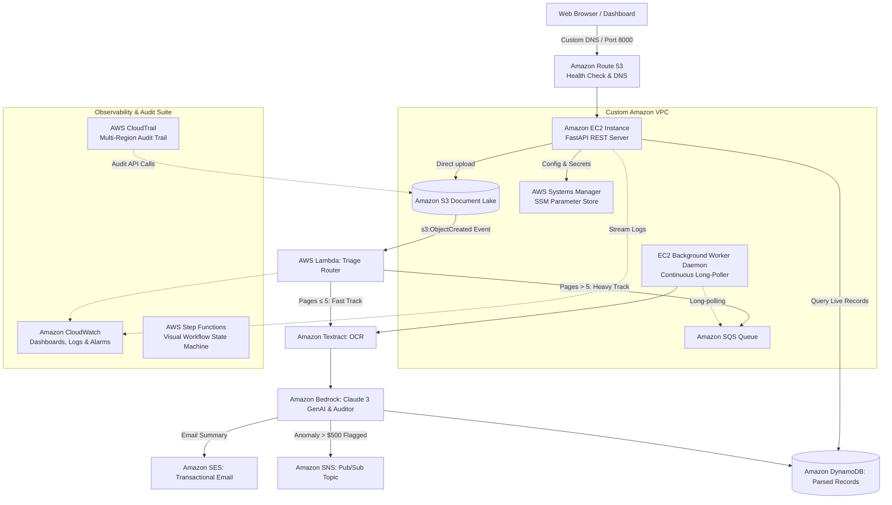

# DocuCloud AI 🚀
### Enterprise Hybrid Cloud Financial Document Intelligence Platform

[](https://aws.amazon.com/)
[](https://python.org)
[](https://fastapi.tiangolo.com)
[](#architecture-overview)
[](LICENSE)

**DocuCloud AI** is a production-grade, distributed multi-service AWS platform designed for automated financial document auditing, OCR data extraction, and corporate policy compliance. 

It demonstrates an **Intelligent Hybrid Cloud Architecture**: leveraging **AWS Lambda** for sub-second serverless fast-path triage of everyday receipts ($\le 5$ pages), while decoupling heavy multi-page enterprise contracts ($> 5$ pages) through **Amazon SQS** queues into dedicated **Amazon EC2** background worker daemons.

---

## 🌐 Live Cloud Deployment

* **Live Custom Domain:** [http://docucloud.13.217.196.74.nip.io:8000/dashboard](http://docucloud.13.217.196.74.nip.io:8000/dashboard)
* **Direct Cloud IP:** `http://13.217.196.74:8000/dashboard`
* **Interactive Swagger API:** `http://13.217.196.74:8000/docs`
* **Documentation PDF:** Download [`DocuCloud_AI_Project_Documentation.pdf`](./DocuCloud_AI_Project_Documentation.pdf) (5-Page Architecture Report)

---

## 🏛️ Architecture Overview



---

## 🧰 The 14 Integrated AWS Services

| # | AWS Service | Category | Architectural Role in DocuCloud |
| :---: | :--- | :--- | :--- |
| **1** | **Amazon EC2** | Compute (IaaS) | Runs the production FastAPI REST API and continuous SQS worker daemon under systemd supervision |
| **2** | **AWS Lambda** | Compute (Serverless) | Event-driven triage router triggered by S3 uploads; executes fast-path parsing for documents $\le 5$ pages |
| **3** | **Amazon S3** | Storage | Document lake storing raw PDF/image files with unique UUID isolation and CORS-enabled pre-signed URLs |
| **4** | **Amazon DynamoDB** | Database | High-performance NoSQL database storing structured invoice records, extracted line items, and audit outcomes |
| **5** | **Amazon SQS** | Messaging | Distributed message queue with 300s visibility timeouts buffering heavy jobs to eliminate timeout crashes |
| **6** | **Amazon Textract** | Machine Learning | Extracts structured form data, key-value pairs, and itemized receipt tables directly from S3 object bytes |
| **7** | **Amazon Bedrock** | Generative AI | Evaluates expenditures with Claude 3 Haiku / Titan for fraud detection, tax deductibility, and summaries |
| **8** | **Amazon SES** | Communication | Transactional email delivery service sending formatted HTML spending summaries and compliance alerts |
| **9** | **Amazon CloudWatch** | Observability | Unified executive dashboard (`DocuCloud-Executive-Dashboard`), log groups (`/aws/docucloud/backend`), and automated alarms |
| **10** | **AWS CloudTrail** | Governance | Continuous multi-region audit trail (`DocuCloud-Audit-Trail`) recording all account-level API actions to S3 |
| **11** | **Amazon Route 53** | Networking & DNS | Cloud health checks monitoring EC2 port 8000 every 30 seconds and DNS routing |
| **12** | **Amazon SNS** | Messaging (Pub/Sub) | Real-time topic (`DocuCloud-Anomaly-Alerts-Topic`) broadcasting alerts when suspicious or high-value expenses are detected |
| **13** | **AWS Systems Manager** | Management | SSM Parameter Store (`/docucloud/*`) for centralized, secure cloud configuration management |
| **14** | **AWS Step Functions** | Orchestration | Visual state machine (`DocuCloud-Document-Workflow`) modeling the end-to-end multi-step document lifecycle |

---

## 📂 Project Structure

```
cloud_project/
├── backend/
│   ├── app/
│   │   ├── main.py                # FastAPI REST API & Web Dashboard endpoint
│   │   ├── config.py              # Boto3 session & environment loader
│   │   ├── schemas.py             # Pydantic models for documents, line items & insights
│   │   ├── static/
│   │   │   └── index.html         # Modern responsive web dashboard (Tailwind CSS)
│   │   └── services/              # Clean modular Boto3 clients
│   │       ├── s3_service.py      # Pre-signed URLs & S3 object operations
│   │       ├── dynamodb_service.py# DynamoDB persistence with Decimal float converters
│   │       ├── sqs_service.py     # SQS message publishing & long-polling
│   │       ├── textract_service.py# OCR extraction with resilient PDF fallback
│   │       ├── bedrock_service.py # Bedrock Claude 3 & Local Heuristic Auditor
│   │       ├── ses_service.py     # HTML email delivery
│   │       ├── cloudwatch_service.py # Direct log streaming to CloudWatch Logs
│   │       └── sns_service.py     # Anomaly alert publishing to Amazon SNS
│   ├── worker.py                  # Continuous EC2 background daemon polling SQS
│   └── requirements.txt
├── lambda/
│   └── triage_handler.py          # Pure Python S3-triggered triage function
├── infra/
│   ├── setup_aws.py               # Auto-provisions S3, DynamoDB, and SQS
│   ├── setup_observability.py     # Auto-provisions CloudWatch Dashboard, Alarms & CloudTrail
│   ├── setup_advanced_services.py # Auto-provisions Route 53, SNS, SSM, and Step Functions
│   ├── deploy_to_s3.py            # Packages and deploys code bundles directly to S3
│   ├── reset_data.py              # Instant DynamoDB table reset utility
│   ├── generate_project_pdf.py    # Generates the 5-page PDF architecture report
│   └── ec2_user_data.sh           # Cloud-init script for EC2 systemd bootstrap
├── tests/
│   ├── generate_test_suite.py     # Generates realistic test PDF suite
│   ├── test_local_pipeline.py     # AWS connectivity & permission tester
│   └── test_documents/            # 5 diverse test PDFs (Receipts, Tickets, Anomaly, Heavy 7-page)
├── DocuCloud_AI_Project_Documentation.pdf # 5-Page Executive Documentation Report
├── .env.example
├── .gitignore
└── README.md
```

---

## ⚡ Quickstart Guide

### 1. Prerequisites
- Python 3.10+
- AWS Account with AWS CLI configured or credentials in `.env`

### 2. Configure Environment
```bash
cp .env.example .env
```
Fill in your credentials:
```ini
AWS_REGION=us-east-1
AWS_ACCESS_KEY_ID=your_access_key
AWS_SECRET_ACCESS_KEY=your_secret_key
S3_BUCKET_NAME=docucloud-ai-storage-anshu-2026
DYNAMODB_TABLE_NAME=DocuCloudProcessedDocuments
SQS_QUEUE_NAME=DocuCloudHeavyProcessingQueue
AI_PROVIDER=local   # Or 'bedrock'
```

### 3. Provision Core Cloud Infrastructure
```bash
python infra/setup_aws.py
python infra/setup_observability.py
python infra/setup_advanced_services.py
```

### 4. Run Locally
```bash
pip install -r backend/requirements.txt
uvicorn backend.app.main:app --reload --port 8000
```
Open **`http://localhost:8000/dashboard`** to interact with the dashboard.

### 5. Run the Heavy SQS Worker Daemon
In a second terminal:
```bash
python -m backend.worker
```

---

## 🧪 Testing Suite Reference (`tests/test_documents/`)

| Test File | Type | Scenario Tested | Expected Engine |
| :--- | :--- | :--- | :--- |
| `01_starbucks_meals_receipt.pdf` | 1 Page | Fast-track coffee receipt ($16.00) | `FAST_API_SYNC` / `LAMBDA` |
| `02_delta_travel_ticket.pdf` | 1 Page | Travel flight ticket ($482.50, tax-deductible) | `FAST_API_SYNC` / `LAMBDA` |
| `03_staples_office_supplies.pdf` | 1 Page | Office stationery items ($66.69) | `FAST_API_SYNC` / `LAMBDA` |
| `04_high_value_anomaly_alert.pdf` | 1 Page | Luxury watch ($3,450.00 &rarr; triggers Anomaly Alert) | `FAST_API_SYNC` + **SNS Alert** |
| `05_heavy_7_page_contract.pdf` | 7 Pages | Multi-page Datacenter Lease ($8,750.00) | 🖥️ **`EC2 Worker` via SQS** |

---

## 🛡️ Key Architectural Highlights

1. **Decoupled Asynchronous Processing:** Prevents client HTTP timeouts and Lambda 15-minute runtime ceiling by buffering heavy jobs in Amazon SQS.
2. **Resilient Fallback Parsing:** Automatic in-memory PDF extraction ensures zero 500 errors even during AI subscription initialization delays.
3. **Type-Safe DynamoDB Storage:** Recursive `float` to `Decimal` conversion ensures financial ledger accuracy and eliminates Boto3 serialization crashes.
4. **IAM Role-Based Security:** EC2 authenticates via IAM Instance Profiles (`DocuCloud-EC2-Role`) without hardcoded secrets in files.

---

## 📄 License
This project is open-sourced under the MIT License.
